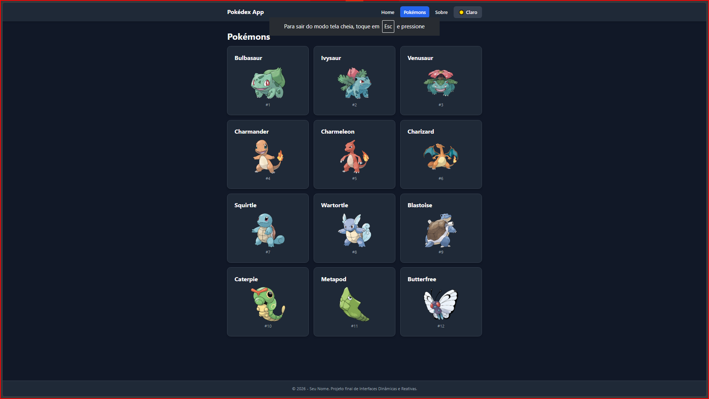
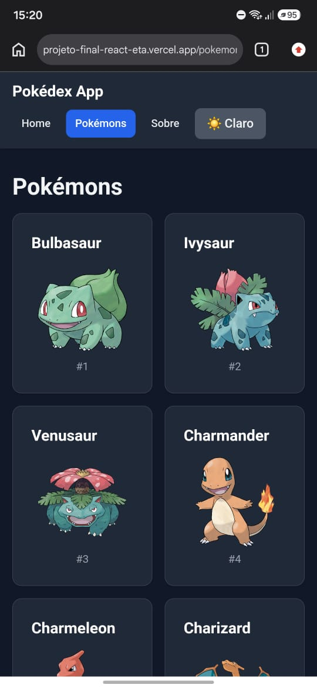

# Pokédex App - Projeto Final

Aplicação React de Pokédex feita para o projeto final de Interfaces Dinâmicas e Reativas.

🔗 **Deploy:** https://projeto-final-react-eta.vercel.app

## Prints de tela

**Desktop**

**Mobile**

## Tecnologias utilizadas

- React
- Vite
- Tailwind CSS (com tema claro/escuro)
- React Router
- Context API
- PokeAPI
- Vercel (deploy)

## Funcionalidades

- Navegação entre páginas (Home, Pokémons, Sobre) sem recarregar
- Listagem de Pokémons consumindo a PokeAPI, com estados de carregamento e erro
- Tema claro/escuro salvo no localStorage
- Layout responsivo

## Estrutura de pastas

    src/
    ├── components/   componentes reutilizáveis
    ├── pages/        páginas ligadas às rotas
    ├── services/     comunicação com a API
    ├── contexts/     Context API (tema)
    └── hooks/        hooks personalizados

## Como rodar localmente

    git clone https://github.com/joaovtorgs1/projeto-final-react.git
    cd projeto-final-react
    npm install
    npm run dev

Para gerar o build de produção:

    npm run build

## Reflexão

**Qual o impacto de ter um projeto documentado e publicado no seu portfólio como desenvolvedor? Por que o README é a primeira coisa que um recrutador lê?**

Um projeto publicado mostra que sei entregar um produto completo, e não só escrever código: ele passa por desenvolvimento, build e deploy e pode ser usado por qualquer pessoa com um link. A documentação mostra organização e comunicação, qualidades muito valorizadas no mercado, e permite que outros desenvolvedores entendam e rodem o projeto sem precisar me perguntar.

O README é a primeira coisa que o recrutador lê porque é a "capa" do repositório: aparece logo abaixo da lista de arquivos. Como ele tem pouco tempo para olhar vários candidatos, é ali que decide se vale a pena continuar. Em poucos segundos ele vê o que o projeto faz, as tecnologias, os prints e o link do deploy. Um README bem feito passa profissionalismo e cuidado, enquanto a ausência dele faz o projeto parecer incompleto, mesmo que o código seja bom.

**Autor:** João Vitor Gomes de Souza
